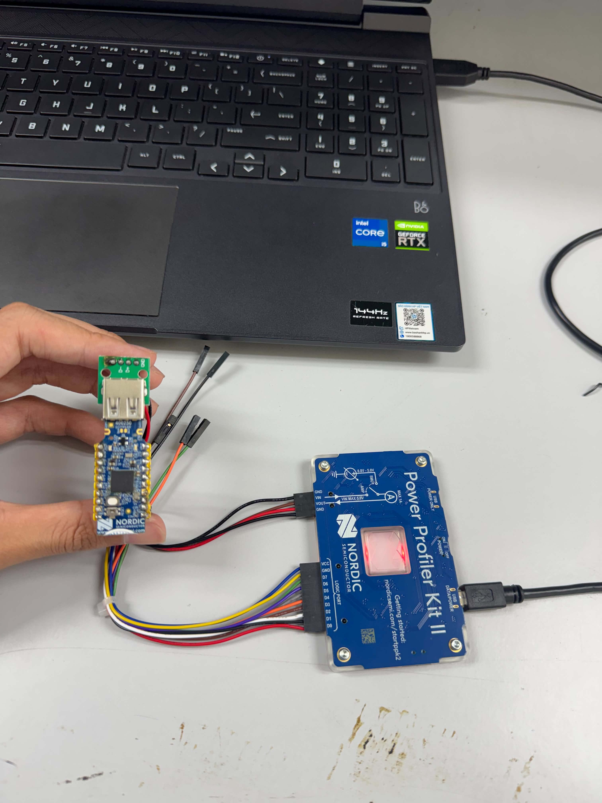
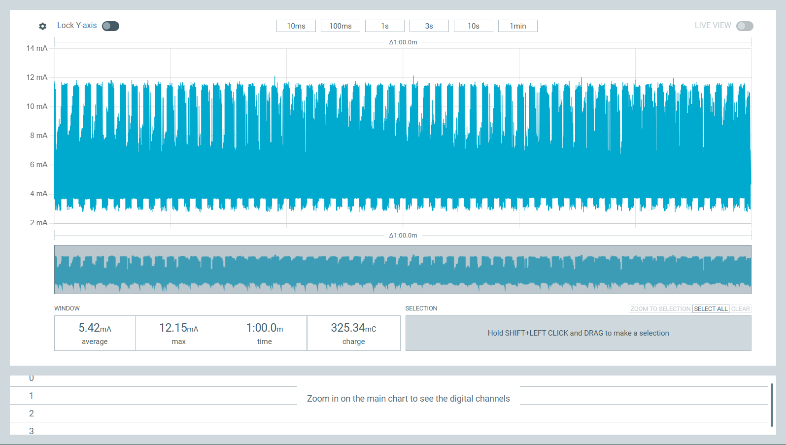
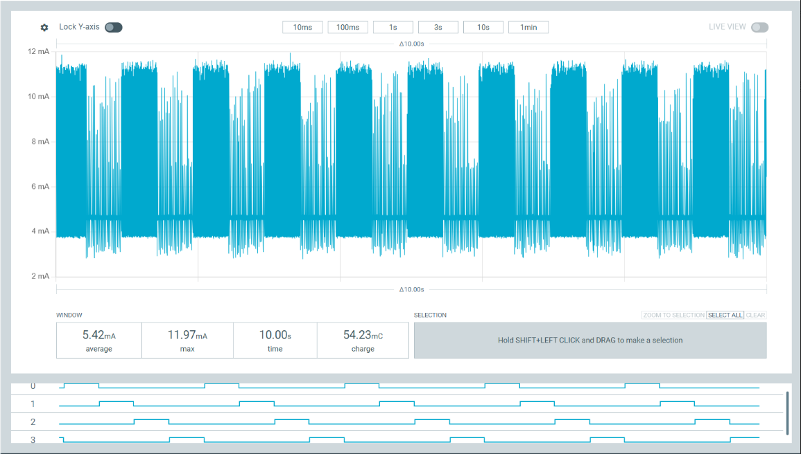
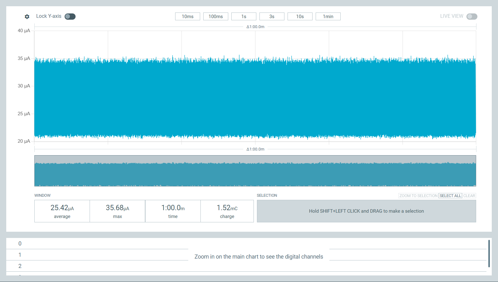
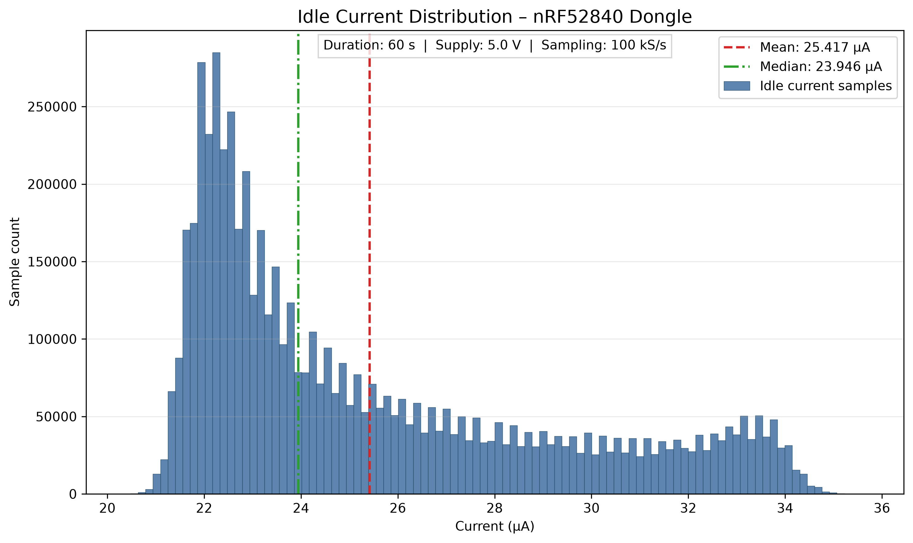

# Báo cáo SV1 tuần 2 — đo dòng bằng PPK2

## 1. Mục tiêu

Tuần 2 đo dòng tiêu thụ của nRF52840 Dongle bằng Nordic Power Profiler Kit II
(PPK2) với ba mục tiêu:

- xác nhận firmware Active và bốn GPIO marker hoạt động đúng trên thiết bị;
- xây dựng firmware Idle riêng để đo dòng nền;
- có quy trình đo và phân tích tái lập được cho các tuần sau.

## 2. Phần cứng và cách cấp nguồn

- Thiết bị: Nordic nRF52840 Dongle PCA10059.
- Thiết bị đo: PPK2 ở chế độ Source Meter, tức PPK2 vừa cấp nguồn vừa đo dòng,
  điện áp 5,0 V.
- Nguồn được đưa vào dongle qua USB breakout. Không sửa cầu hàn SB1/SB2.
- Kênh logic D0–D3 của PPK2 nối lần lượt với P0.13, P0.15, P0.17 và P0.20.



Khi PPK2 đang cấp nguồn qua USB breakout, không cấp nguồn đồng thời từ cổng
USB máy tính. Nạp DFU qua bootloader USB là bước riêng, không làm trong phiên
phân tích dữ liệu.

## 3. Cấu hình PPK2

| Thông số | Giá trị |
|---|---|
| Chế độ | Source Meter |
| Điện áp | 5,0 V |
| Tần số lấy mẫu | 100.000 mẫu/s (100 kS/s) |
| Thời gian mỗi bản ghi | 60 s |

Active và Idle được đo với cùng phần cứng, nguồn và cách nối.

## 4. Firmware Active và GPIO marker

Firmware Active giữ USB CDC, LED heartbeat và benchmark DWT của tuần 1, thêm
module marker trên GPIO Port 0. Mỗi cạnh marker là đúng một lần ghi thanh ghi
`OUTSET` hoặc `OUTCLR`, nên thời điểm bật/tắt marker không bị trễ bởi driver:

| Kênh logic | Chân | Nhãn firmware |
|---|---|---|
| D0 | P0.13 | HEAD |
| D1 | P0.15 | PROTECTION |
| D2 | P0.17 | TX |
| D3 | P0.20 | WAIT |

Ở chế độ tự kiểm, firmware chuyển marker mỗi 500 ms để kiểm tra thứ tự và
thời gian trên PPK2.





Phép đo Active dùng để xác nhận firmware chạy, chu kỳ và logic marker; chưa
phải số liệu năng lượng cuối cùng. Build hiện tại bằng `build_week1_demo.ps1`
PASS trên đúng target, dùng 49.244 B Flash và 18.296 B RAM, và tạo được gói DFU.

## 5. Firmware Idle

Idle dùng chung project nhưng lấy `overlay-idle.conf` làm `CONF_FILE` hoàn
chỉnh. Khi `CONFIG_APP_IDLE_MEASUREMENT=y`, CMake chọn `main_idle.c`; Active
vẫn là mặc định từ `prj.conf`.

Khi khởi động, firmware Idle:

- cấu hình D0–D3 là output mức LOW, không chạy tự kiểm marker;
- tắt cả bốn LED trên board;
- tắt USB device stack, serial console, logging, `printk` và boot banner;
- không chạy benchmark hay vòng lặp bận;
- gọi `k_sleep(K_FOREVER)` để luồng chính ngủ vô thời hạn, nhường CPU cho
  luồng idle của Zephyr.

Build Idle không đụng tới bootloader và tạo gói riêng
`device/artifacts/adaptive_split_week2_idle.zip`. `build_week2_idle.ps1` PASS,
dùng 19.476 B Flash và 6 KB RAM; `nrfutil pkg display` xác nhận gói có một
application image 19.476 B. Cả hai gói Active và Idle đều không ký, chỉ dùng
cho quy trình demo.

## 6. Quy trình đo 60 giây

1. Kiểm tra dongle không còn cắm vào USB máy tính.
2. Nối PPK2 và USB breakout như ảnh ở mục 2.
3. Chọn Source Meter 5,0 V, lấy mẫu 100 kS/s.
4. Nối D0–D3 vào đúng bốn chân marker.
5. Ghi 60 giây cho Active hoặc Idle với cùng cấu hình.
6. Lưu raw CSV/PPK2 ở máy cục bộ rồi chạy script phân tích để sinh summary và hình.



## 7. Kết quả Idle

Nguồn số liệu:
[`results/week2/device/summary/week2_idle_summary.csv`](../results/week2/device/summary/week2_idle_summary.csv).

| Đại lượng | Kết quả |
|---|---:|
| Số mẫu | 6.000.001 |
| Thời lượng | 60,000000000 s |
| Tần số lấy mẫu thực tế | 100.000,000000 Hz |
| Mean | 25,416651984 µA |
| Độ lệch chuẩn mẫu | 3,706868927 µA |
| Min | 20,328000000 µA |
| Max | 35,683000000 µA |
| Median | 23,946000000 µA |
| Percentile 95% | 33,124000000 µA |
| Percentile 99% | 34,051000000 µA |
| Điện tích tích phân | 1,524999098 mC |

Làm tròn: mean 25,417 µA, độ lệch chuẩn mẫu 3,707 µA, median 23,946 µA, điện
tích 1,525 mC. Điện tích là tích phân dòng theo thời gian (quy tắc hình thang)
trên toàn bộ 60 s.

CSV có đủ bốn kênh D0–D3. Trên toàn bộ 6.000.001 mẫu, mỗi kênh có 0 mẫu
không ở mức LOW và 0 mẫu không hợp lệ (`all_low=TRUE`), đúng hành vi thiết kế
của firmware Idle.



Histogram lệch phải: phần lớn mẫu nằm ở vùng dòng thấp, một số mẫu dòng cao
hơn tạo đuôi bên phải, nên mean cao hơn median. Hình có đường đánh dấu
mean/median và chú thích 60 s, 5,0 V, 100 kS/s.

## 8. Quản lý dữ liệu và chạy lại phân tích

Raw CSV và PPK2 nằm ở `results/week2/device/raw/` trên máy cục bộ. `.gitignore` loại
`results/**/raw/`, `*.ppk` và `*.ppk2`, nên Git chỉ lưu script phân tích,
summary, README và hình. Dữ liệu raw không bị sửa hoặc đổi tên khi tạo báo cáo.

Từ Git root, khi có file raw:

```powershell
python .\tools\analyze_week2_idle.py .\results\week2\device\raw\2026-09-22_idle_vbus5v_60s.csv
```

Script nhận diện cột và đơn vị từ header, đọc theo từng khối, dùng file tạm
dạng memory map để tính percentile chính xác, tích phân hình thang (kể cả
đoạn nối giữa hai khối) và kiểm tra D0–D3. File raw chỉ được đọc.

## 9. Hạn chế

- Dòng đo là dòng vào ở 5,0 V của toàn dongle trong cấu hình cấp nguồn trên,
  không tách riêng từng khối trong SoC và không so trực tiếp được với số liệu
  datasheet đo ở điện áp nguồn khác.
- Chưa phân tích độ không đảm bảo đo hay hiệu chuẩn độc lập PPK2.
- Một bản ghi Idle 60 giây chỉ mô tả đúng trạng thái đã đo, chưa bao quát nhiệt
  độ, nguồn hay firmware khác.
- Active hiện chỉ xác nhận marker và chu kỳ, chưa có năng lượng cho một lần
  suy luận hoàn chỉnh.
- Xung khởi động trước cửa sổ ghi có thể không nằm trong bản ghi 60 giây.

## 10. Kết luận

Tuần 2 đã có quy trình đo tái lập được cho Active và Idle, ánh xạ rõ bốn
marker, xác nhận D0–D3 luôn LOW trong Idle và đo được dòng nền trung bình
khoảng 25,417 µA ở 5,0 V. Raw được giữ ngoài Git; summary, script và hình được
lưu để kiểm tra lại kết quả.
