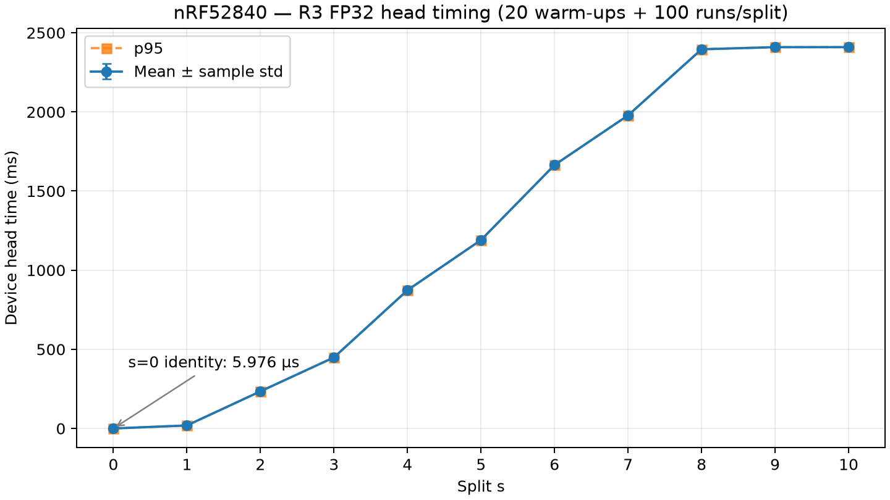

# Báo cáo SV1 tuần 4 — 11 điểm cắt FP32 trên nRF52840 Dongle

**Sinh viên thực hiện:** SV1/Châu. **Ngày lập báo cáo:** 04/10/2026.
**Ngày đo và nghiệm thu trên dongle:** 02/10/2026, múi giờ Asia/Saigon.

## 1. Mục tiêu và phạm vi

Tuần 4 mở rộng đầu suy luận đến P2 của [tuần 3](sv1_device_week3_report.md)
thành **11 điểm cắt `s=0..10`** của mô hình ECG MIT-BIH, dùng gói R3 do
SV3/Kỳ Anh bàn giao. *Split* (điểm cắt) là vị trí chia mô hình; *head* là phần
mô hình chạy từ đầu vào đến vị trí đó trên thiết bị. Mỗi điểm cắt được kiểm
trên 20 mẫu và đo thời gian tính trên Nordic nRF52840 Dongle PCA10059 thật.

Tiêu chí nghiệm thu: đầu ra firmware khớp *golden* (tensor tham chiếu PyTorch
xuất từ mô hình đã chốt) với sai số tuyệt đối lớn nhất của **từng mẫu, từng
split `< 1e-3`** (nghiêm ngặt). FP32 là số thực dấu phẩy động 32 bit; tuần này
giữ nguyên FP32, mô hình, tiền xử lý, thứ tự mẫu và ngưỡng sai số. SV1 làm phần
xác thực đầu vào, mở rộng kernel C, build/DFU, thu tensor, đo thời gian và kiểm
chứng trên thiết bị. Truyền Device–Edge và KV260 thuộc giai đoạn tích hợp sau.

Kết quả chính: **220/220 tensor PASS, chuỗi đổi mẫu/split 16/16 PASS,
1.100/1.100 số đo thời gian hợp lệ**, và P2 của 20 mẫu khớp từng bit với MCU
tuần 3. Kết luận dựa trên [capture và hồ sơ kiểm chứng](../results/week4/README.md),
không suy từ việc build thành công hay thấy banner `READY`.

## 2. Thiết bị, nguồn và môi trường

- Nordic nRF52840 Dongle PCA10059: Cortex-M4 có FPU (khối tính số thực phần
  cứng), CPU 64 MHz. Dongle lấy nguồn USB từ máy tính khi nạp DFU và thu USB CDC
  (cổng COM ảo để gửi lệnh, nhận kết quả). **Tuần 4 không đo dòng/năng lượng
  bằng PPK2**; cấu hình Source Meter 5,0 V của tuần 2 không áp dụng cho phép đo này.
- Máy phát triển Windows 11, PowerShell; NCS v3.4.0, Zephyr v4.4.0, target
  `nrf52840dongle/nrf52840`, West với `--no-sysbuild`, GNU Arm GCC 14.3.0 từ
  Zephyr SDK 1.0.1. [Biên bản môi trường](../device/reports/environment_check.txt)
  ghi cấu hình nền; [provenance tuần 4](../results/week4/week4_mcu_validation.json)
  ghi phiên bản NCS/Zephyr/ARM GCC của kết quả này.
- Kiểm chứng và phân tích dùng `ml/.venv` (Python 3.11.9, NumPy 2.4.6, hình
  vẽ bằng Matplotlib 3.11.2). Host C dùng GCC 13.2.0 (MSYS2 UCRT64). Collector
  dùng .NET `SerialPort`, không cần pyserial.
- Phiên đo nhận bootloader là `COM6` (VID:PID `1915:521F`) và ứng dụng là
  `COM7` (VID:PID `2FE3:0004`). Số COM chỉ đúng cho phiên 02/10. Không sửa
  SB1/SB2 hay bootloader.

Trong JSON provenance, `dfu_timestamp` là `2026-10-02T15:31:04.2051223+07:00`
và `validated_at` là `2026-10-02T16:25:33.162465+07:00`: thời điểm nạp DFU và
thời điểm xác thực kết quả, không phải giờ bắt đầu/kết thúc từng lượt đo.
Ngày 04/10 chỉ lập báo cáo và tái kiểm ngoại tuyến, không nạp, không mở COM,
không đo lại.

## 3. Đầu vào R3 và xác thực bàn giao

Nguồn bàn giao là [Release R3 `sv3-week4-r3-20261001`](https://github.com/ChouPro205/Adaptive_Split_Inference/releases/tag/sv3-week4-r3-20261001),
theo [hướng dẫn nhận gói R3](../ml/docs/sv3_sv1_week4_handoff_r3.md) và
[tổng kết phát hành](../ml/docs/week4_r3_completion.md). Gói gồm graph 25 phép
toán, 20 mảng tham số với 109.653 phần tử FP32, header C99, 20 đầu vào,
11 golden và các ONNX tail trong gói all-split bất biến v1
`mitdb-week3-sv2-fp32-20261001-v1`.

Artifact lớn nằm ngoài Git. Để nhận đủ gói, tải từ Release: **source bundle**
`adaptive-split-inference-r3.bundle`, **artifact ZIP**
`mitdb-sv1-week4-fp32-20261001-r3.zip`, `source_transfer_receipt.json`,
`deliverables.json` và `SHA256SUMS.txt`. Phải xác thực receipt qua checkout
hoặc kênh tin cậy, đối chiếu SHA-256 (mã băm xác định đúng nội dung file) và
kích thước trước khi clone/hydrate; không giải nén rồi chạy source bất kỳ.

| Thành phần bàn giao | Kích thước (B) | SHA-256 |
| --- | ---: | --- |
| Source bundle R3 | 3.718.066 | `711ddbdb8e69beeb70c4409752339232a9f8ab60e602f6d03c0f07215fdcd91b` |
| Artifact ZIP R3 | 5.659.073 | `4426bcd48282f84721d3dc00404de2e0cfaf38891e8fae850d15622323b972ff` |
| Manifest R3 | Theo inventory | `80e4cea3b70bdafef1b6925b208d4951a87bba4ff8cf10dbb6a671e36439635c` |
| Manifest all-split v1 | Theo inventory | `a6d16809036c035936825b0e0cdc178e0bdf9f53ca81a132ece0522911d3d2a6` |

Commit source bàn giao là `2506239d62f620a41b860f4487ca3ee58c349cd5`; commit
sinh artifact là `c793c06385198accc964e0e60988d7e7a7e9b566`. Hai commit khác
nhau vì evidence được bổ sung sau khi phát hành.

Hồ sơ máy nhận ở `D:/HUST/SV3_week4_R3/receiver-audit/` ghi: clone bundle,
checkout detached đúng SHA bàn giao, kiểm 21 source binding, hydrate đủ 69 file
(41 all-split + 28 R3), mọi gate bắt buộc exit 0. Kết quả: 220 golden khớp
bitwise, tái tạo 26 file khoa học trùng byte và 200 phép so ONNX strict `<1e-3`.
Bộ kiểm cache có 10 PASS và **1 SKIP vì Windows thiếu quyền tạo symlink thật
(WinError 1314)**; guard mô phỏng vẫn PASS. Đây là kiểm bàn giao ngoại tuyến,
chưa phải kiểm chứng MCU.

Tài liệu và receipt phát hành giữ trạng thái lịch sử `SV1_RECEIPT_PENDING`;
ACK trong hồ sơ máy nhận là `DRAFT_NOT_SENT`. Báo cáo này ghi kết quả kỹ thuật
đã kiểm trên máy nhận và dongle, không coi ACK là đã gửi và không sửa
manifest/receipt bất biến để cập nhật trạng thái ngược về quá khứ.

[`load_handoff()`](../device/scripts/generate_week4_inputs.py) kiểm hai manifest
anchor, inventory SHA/size, source ML theo chính sách UTF-8 LF, graph, tham số,
shape/layout và thứ tự ID trước khi firmware/checker dùng gói. Input là
`(20,1,360)`, FP32 little-endian (`<f4`), **đã chuẩn hóa**, nên firmware không
chuẩn hóa lại. `sample_index=0..19` ánh xạ đúng các dòng `samples.csv` thành
`MIT-BIH:105:<r_peak_sample>:MLII`.

## 4. 11 điểm cắt và ý nghĩa đầu ra

Mapping lấy từ manifest all-split đã xác thực, đối chiếu với
[graph R3](../ml/results/week4-r3/model_graph.json) và
[guide firmware](../device/week4_fp32_guide.md). Shape là kích thước tensor của
**một mẫu**; NCL là thứ tự mẫu–kênh–chiều dài, NC là mẫu–đặc trưng. Mọi tensor
theo C order (phần tử của chiều cuối nằm liên tiếp).

| `s` | Endpoint (mốc cuối của head) | Shape | Layout |
| ---: | --- | --- | --- |
| 0 | `normalized_model_input` – identity | `1×1×360` | NCL |
| 1 | `features.1` | `1×16×360` | NCL |
| 2 | `features.4` – P2 tuần 3 | `1×16×180` | NCL |
| 3 | `features.6` | `1×32×180` | NCL |
| 4 | `features.9` | `1×32×90` | NCL |
| 5 | `features.11` | `1×48×90` | NCL |
| 6 | `features.14` | `1×48×45` | NCL |
| 7 | `features.16` | `1×64×45` | NCL |
| 8 | `features.19` | `1×64×22` | NCL |
| 9 | `classifier.3` | `1×32` | NC |
| 10 | `classifier.4` – logits | `1×5` | NC |

`s=0` là identity: trả nguyên đầu vào, không chạy lớp nào; checker yêu cầu khớp
từng bit FP32. `s=2` là đoạn `Conv1 → ReLU1 → Conv2 → ReLU2 → MaxPool1d`, đúng
mốc tensor P2 của tuần 3 (tên mốc tensor, không phải chế độ bảo vệ P2). `s=10`
chạy toàn bộ graph và trả *logits*: 5 điểm số trước softmax theo thứ tự lớp
`N/S/V/F/Q`, không phải xác suất hay accuracy.

## 5. Mở rộng firmware FP32 và quản lý buffer

[`week4_head.c`](../device/src/week4_head.c) tổng quát hóa kernel C tuần 3:
Conv1d kernel 5, padding 2, stride 1, cộng tích FP32 theo thứ tự kênh ra → vị
trí → kênh vào → kernel rồi mới cộng bias; ReLU đưa giá trị âm về 0; MaxPool1d
lấy max từng cặp (kernel/stride 2); Linear cộng tích rồi cộng bias. Flatten giữ
C order; Dropout ở chế độ eval là identity. Đây là **kernel vòng lặp C của dự
án**, không dùng CMSIS-NN hay X-CUBE-AI; `cmsis_core.h` chỉ dùng để truy cập
thanh ghi CPU/DWT. FPU được bật và `-ffp-contract=off` giữ đúng thứ tự làm tròn
FP32 (không gộp nhân–cộng).

API thực tế là `week4_run_head(split, input, result)`: chọn số phép toán ứng
với `s`, luôn chạy từ input gốc đến endpoint, trả con trỏ đầu ra và shape.
[`main_week4.c`](../device/src/main_week4.c) chọn input theo `sample_index`;
lệnh `RUN n s` chạy mẫu 0–19 tại split 0–10, `BENCH n s` đo thời gian head
tương ứng. [Parser](../device/src/week4_protocol.c) từ chối lệnh/đối số không
hợp lệ. Đổi split không tái sử dụng activation của lệnh trước.

Weights lấy từ `firmware/head_parameters.h` của R3: 20 mảng `static const`,
**438.612 B Flash**. Script sinh `week4_inputs.h` bằng literal hex FP32 (giữ
nguyên bit của 20 input, 28.800 B Flash) và `week4_graph.h` từ graph. Hai
buffer activation A/B, mỗi buffer 5.760 float = 23.040 B, luân phiên cho
Conv/Pool/Linear; ReLU tính tại chỗ. Tổng activation RAM **46.080 B**. Đầu ra
chỉ hợp lệ đến lần gọi head kế tiếp; `s=0` trả lại con trỏ input. API dùng
workspace chung nên chỉ một luồng gọi tại một thời điểm.

[`overlay-week4.conf`](../device/overlay-week4.conf),
[`CMakeLists.txt`](../device/CMakeLists.txt) và
[script build riêng](../device/scripts/build_week4_head.ps1) chọn
`CONFIG_APP_WEEK4_HEAD=y`, thư mục `device/build-week4` và ZIP DFU tuần 4.
Một build hồi quy tuần 3 ở thư mục riêng kiểm phần CMake/Kconfig dùng chung;
kernel, image đã nghiệm thu và bằng chứng tuần 3 giữ nguyên.

## 6. Ba tầng kiểm chứng: host C, build, MCU thật

| Tầng | Bằng chứng và kết quả | Ý nghĩa |
| --- | --- | --- |
| Host C trên máy tính | Cùng source kernel C: 220/220 chiều thuận và 220/220 thứ tự đảo PASS; P2 so với C tuần 3 bitwise 20/20; 440 lệnh hợp lệ và 17 lệnh không hợp lệ được kiểm | Kiểm logic, shape, sai số và trạng thái buffer trước khi nạp |
| Build/linker/DFU | Build tuần 4 và build hồi quy tuần 3 exit 0; đối chiếu ELF/HEX, phân vùng và ZIP; DFU exit 0 | Xác nhận tạo và nạp đúng image; chưa chứng minh đầu ra số học |
| MCU trên dongle | Capture đủ 220 RUN chính thức, 16 RUN đổi mẫu/split và 11 BENCH; checker PASS | Xác nhận tensor thật và thời gian của image trên PCA10059 |

Host dùng [`verify_week4_host.py`](../device/scripts/verify_week4_host.py); hồ sơ
chuẩn bị ở `D:/HUST/SV3_week4_R3/firmware-build/` gồm
`week4_host_validation.json`, `preparation_summary.json`, log build và báo cáo
bộ nhớ. Các trường MCU `PENDING` trong hồ sơ chuẩn bị là trạng thái **trước
DFU**, không phủ định [JSON MCU sau phép đo](../results/week4/week4_mcu_validation.json).
Khi lập báo cáo chỉ đọc hồ sơ này và chạy checker capture ngoại tuyến.

## 7. Kết quả số học trên MCU: 20 mẫu × 11 split

Firmware in mỗi phần tử dưới dạng 8 chữ số hex của bit FP32, không làm tròn
thập phân. [`check_week4_capture.py`](../device/scripts/check_week4_capture.py)
xác thực gói, banner R3, sample ID, thứ tự lệnh, shape/layout, số phần tử, giá
trị hữu hạn và khung `BEGIN/END/DONE`; sau đó giải mã FP32, đổi sang float64
để tính `max(abs(MCU − golden))`. Mỗi ca phải `<1e-3`; bằng đúng `1e-3` cũng
không đạt.

**220/220 ca chính thức PASS.** Sai số lớn nhất là **`1.430511474609375e-05`**,
tại `sample_index=6`, `sample_id=MIT-BIH:105:1741:MLII`, **`s=9`** (shape
`1×32`). Bảng dưới lấy max trên 20 mẫu của từng split từ
[CSV đầy đủ 20×11](../results/week4/week4_errors_20x11.csv), làm tròn để dễ
đọc; CSV giữ giá trị đầy đủ. Sai số là chênh lệch giá trị tensor, không có đơn vị.

| `s` | Sai số tuyệt đối lớn nhất trên 20 mẫu | Số ca PASS (`<1e-3`) |
| ---: | ---: | ---: |
| 0 | `0` | 20/20 |
| 1 | `4.76837158e-07` | 20/20 |
| 2 | `7.15255737e-07` | 20/20 |
| 3 | `4.76837158e-07` | 20/20 |
| 4 | `4.76837158e-07` | 20/20 |
| 5 | `5.96046448e-07` | 20/20 |
| 6 | `7.15255737e-07` | 20/20 |
| 7 | `1.43051147e-06` | 20/20 |
| 8 | `3.81469727e-06` | 20/20 |
| 9 | `1.43051147e-05` | 20/20 |
| 10 | `5.60283661e-06` | 20/20 |

Chuỗi bổ sung **16/16 PASS** kiểm việc đổi mẫu/split liên tiếp trên cùng
firmware và workspace; mỗi cặp là `(sample_index, s)`:

```text
(19,10), (0,0), (7,8), (3,2), (19,1), (0,10), (12,0), (1,9),
(18,4), (2,7), (14,6), (5,3), (11,5), (0,2), (19,10), (0,0)
```

Mọi ca `s=0` giữ nguyên bit input. **20/20 đầu ra P2 (`s=2`) khớp từng bit với
capture MCU tuần 3** đã nghiệm thu (sai số giữa hai lần chạy MCU bằng 0). Mốc
đối chiếu là [capture 20×5 tuần 3](../results/week3/logs/week3_capture_20x5.txt)
và [JSON tuần 3](../results/week3/week3_mcu_validation_20x5.json), capture SHA-256
`72c7b6a2ba554f7e6d242a49e20065a4b56a3967108206a9a4d8845f1e795606`. Sai số P2
so với **golden PyTorch** vẫn khác 0 như bảng trên: đó là hai phép đối chiếu
với hai tham chiếu khác nhau.

## 8. Đo thời gian head

**Phương pháp.** Dùng **mẫu 0 cố định** (`MIT-BIH:105:197:MLII`); mỗi split
chạy **20 lần warm-up rồi 100 lần đo**, tổng **1.100 số đo** cho 11 split. Đây
không phải thời gian trên cả 20 mẫu. DWT `CYCCNT` là bộ đếm chu kỳ CPU phần
cứng; với CPU **64 MHz**:

```text
time_ms = cycles / 64000000 × 1000
```

Firmware đọc DWT ngay trước và sau `week4_run_head()`. **Ngắt (IRQ) bị khóa
trong từng lần gọi head** và mở lại giữa các lần; GPIO, USB, log, phân tích
lệnh, chờ lệnh và so golden đều nằm ngoài khoảng đo. Cycles chỉ được in sau khi
xong toàn bộ batch. Số đo gồm cả phần chọn phép toán và xử lý shape của API;
`s=0` được đo thật, không gán 0 và không trừ baseline. Tần số RTC/tick 32.768 Hz
của Zephyr không dùng để đổi DWT cycles sang thời gian.

*Mean* là trung bình; *std* là độ lệch chuẩn mẫu (mẫu số `n−1`, `ddof=1`);
*p95* là phân vị 95%, nội suy tuyến tính kiểu NumPy với vị trí `h=(n−1)×0,95`.
Bảng tính bằng **ms**, làm tròn 9 chữ số thập phân;
[CSV 1.100 lượt](../results/week4/week4_timing_1100.csv) lưu cycles và thời gian
từng lượt, [CSV tổng hợp](../results/week4/week4_timing_summary.csv) lưu đủ
mean/std/p95/min/max.

| `s` | Số lượt đo | Mean (ms) | Std (ms) | P95 (ms) |
| ---: | ---: | ---: | ---: | ---: |
| 0 | 100 | 0.005975937 | 0.000050566 | 0.005968750 |
| 1 | 100 | 18.977718750 | 0.000800890 | 18.978515625 |
| 2 | 100 | 234.458281250 | 0.000000000 | 234.458281250 |
| 3 | 100 | 448.941296875 | 0.000000000 | 448.941296875 |
| 4 | 100 | 873.582734375 | 0.000000000 | 873.582734375 |
| 5 | 100 | 1190.511750000 | 0.000000000 | 1190.511750000 |
| 6 | 100 | 1664.525390625 | 0.000000000 | 1664.525390625 |
| 7 | 100 | 1978.064906250 | 0.000000000 | 1978.064906250 |
| 8 | 100 | 2395.608343750 | 0.000000000 | 2395.608343750 |
| 9 | 100 | 2409.012078125 | 0.000000000 | 2409.012078125 |
| 10 | 100 | 2409.063171875 | 0.000000000 | 2409.063171875 |



*Hình 1. Trục ngang là split `s=0..10`; trục dọc là thời gian head trên thiết bị
(ms). Đường xanh là mean ± std mẫu, đường cam là p95. Điều kiện: mẫu 0 cố định,
20 warm-up + 100 lượt/split, DWT 64 MHz, khóa IRQ trong từng lần gọi head;
USB/log/chờ lệnh nằm ngoài phép đo. `s=0` khoảng 5,976 µs (1 µs = 0,001 ms),
rất nhỏ so với thang trục chung.*

**Nhận xét.** Mean tăng theo độ dài head, không có điểm giảm. **Std = 0 tại
`s=2..10` vì 100 giá trị cycles của mỗi split giống hệt nhau** trong phiên đo
(ngắt bị khóa, cùng một mẫu đầu vào). Điều này không có nghĩa thời gian sẽ
không dao động trong điều kiện khác. Tại `s=0`,
p95 nhỏ hơn mean vì vài lượt cao hơn kéo trung bình lên.

`s=10` có mean **2.409,063171875 ms ≈ 2,409 giây**. Đây là **thời gian tính toán
cô lập**, chưa phải độ trễ end-to-end khi RTOS và truyền thông chạy đồng thời,
nên chưa đủ căn cứ kết luận về đáp ứng thời gian thực.

Ghi chú bổ sung ngày 15/10/2026 về cách dùng số liệu này:

- Image đã đo build với `CONFIG_SIZE_OPTIMIZATIONS=y` (tối ưu theo kích thước,
  `-Os`), kernel là vòng lặp C đơn giản có kiểm biên padding ngay trong vòng
  lặp trong cùng, không dùng thư viện tối ưu. Mã máy dùng lệnh FPU phần cứng
  (`vmla.f32`). Vì vậy t_dev ở đây là chi phí của **cách hiện thực này**, không
  phải chi phí cố định của mô hình; đổi kernel, mức tối ưu hay chuyển sang INT8
  thì phải đo lại.
- Phép đo khóa ngắt suốt mỗi lần gọi head, tới khoảng 2,4 s ở `s=8..10`. Cách
  này chỉ dùng được trong firmware debug USB hiện tại; khi có radio/BLE, không
  thể khóa ngắt lâu như vậy, nên phương pháp đo sẽ phải thay đổi và số đo khi
  đó sẽ gồm cả chi phí xử lý ngắt.

## 9. Flash, RAM và stack main

Flash lưu chương trình và tham số; RAM là bộ nhớ làm việc.
[Footprint](../results/week4/week4_footprint.json) ghi vùng linker thực tế:

| Vùng bộ nhớ | Đã dùng (B) | Giới hạn (B) | Còn lại theo linker (B) |
| --- | ---: | ---: | ---: |
| Flash ứng dụng DFU | 523.424 | 913.408 | 389.984 |
| RAM tĩnh | 65.464 | 262.144 | 196.680 |

Flash ứng dụng nằm trong `[0x1000,0xe0000)`, sau MBR và trước bootloader, nên
giới hạn nhỏ hơn Flash toàn chip. Weights/bias const 438.612 B và 20 input
28.800 B nằm trong Flash. RAM tĩnh gồm hai buffer activation 46.080 B, mảng
100 cycles 400 B, dữ liệu Zephyr/USB và các stack đã cấp.

Với `CONFIG_INIT_STACKS=y`, `k_thread_stack_space_get()` ghi **mức dùng stack
main lớn nhất 616/4096 B** qua 247 lệnh (high-water: mức sử dụng lớn nhất quan
sát được bằng cách quét vùng stack). ELF cấp 4.224 B cho stack main, gồm phần
guard/alignment; firmware báo phần dùng được là 4.096 B.

**RAM tĩnh khác peak RAM lúc chạy.** Không cộng thêm 616 B hay toàn bộ stack vào
65.464 B, vì stack đã nằm trong RAM linker. Stack của UDC/USBD, workqueue, ISR
và idle đã được cấp trong RAM tĩnh nhưng high-water của chúng **chưa đo**;
616/4096 B chỉ là stack main trong phiên này. Peak RAM toàn hệ thống lúc chạy
cũng **chưa đo**, và phần RAM còn lại theo linker không phải dung lượng trống
nhỏ nhất khi chạy.

## 10. Hiện vật, hash, commit và lệnh tái kiểm

| Bằng chứng trong Git | Nội dung |
| --- | --- |
| [README kết quả tuần 4](../results/week4/README.md) | Điều kiện đo, công cụ và truy nguồn |
| [Capture USB CDC](../results/week4/logs/week4_capture.txt) | 5.772.678 B; 220 RUN + 16 RUN đổi thứ tự + 11 BENCH = 247 tensor |
| [JSON kiểm chứng MCU](../results/week4/week4_mcu_validation.json) | 247 ca, 11 batch/1.100 cycles, 247 quan sát stack và provenance |
| [CSV sai số 20×11](../results/week4/week4_errors_20x11.csv) | 220 ca chính thức: ID/shape/layout/sai số/PASS |
| [CSV timing gốc](../results/week4/week4_timing_1100.csv) và [tổng hợp](../results/week4/week4_timing_summary.csv) | 1.100 lượt và thống kê 11 split |
| [Footprint JSON](../results/week4/week4_footprint.json) | Linker, symbol ELF, bộ nhớ tĩnh và stack main đo được |
| [Hình timing](../results/week4/figures/week4_t_dev.png) | Hình 1, vẽ trực tiếp từ dữ liệu đã nghiệm thu |

Các hash dưới đây đọc từ provenance và được đối chiếu lại với file gốc khi lập
báo cáo. Hash artifact/firmware/capture tính trên **byte thô**; source ML được
xác thực theo chính sách chuẩn hóa UTF-8 LF ghi trong manifest.

| Đối tượng | SHA-256 |
| --- | --- |
| Capture MCU tuần 4 | `c8fa2bd1a2ae69ea922db8a91dba084ac4fb177272c11c071a46817288cd9b71` |
| ZIP DFU tuần 4 | `d13facbca1fd7d83b036361eeea3ef33bdff015d62a9476142cfcc6244faf171` |
| Application binary trong ZIP | `5e6169561f561ee533cc153c1807b7b129d4e1940df54039f0448c726bbd2cae` |
| ELF tuần 4 | `d9a1ef3197705b0aa1d21d64d0420dbea2195dc27c7d36b53ddf89dff107e97c` |
| Input `golden/z_s0.npy` | `dac1d1e9df849bf4ffa30359384d129586f67ec0703157b692d1344685b78dcc` |
| Checkpoint | `9b8be076356e8d42d1d8cb1a8b42fa33a3997f16a5b797e2541ee79392141f90` |
| Graph R3 | `0d0c78df93a81808256c7baa4d8d3a77230fcc5e733e48382dd4b518ccced9ec` |
| Header weights R3 | `3f811758ca6fc6a8fdefa74ff50ccb48031c006e9a12b617604dad033657487b` |
| Sample CSV | `4a6356312d5f62da6b2fdf9e609843d4dea3fc5c20767e201ea21a075e6f227c` |

JSON provenance còn lưu hash của 11 golden, generated header, source đã build
và công cụ thu/kiểm/phân tích. `.gitattributes` trong `results/week4` giữ nguyên
byte của capture khi checkout, tránh đổi hash do CRLF/LF.

Commit ghi kết quả là **`efc0af72aeae3ef6ff872ad3cae19e6304899530`** trên
`dev/device-sv1`, cũng là HEAD lúc bắt đầu lập báo cáo (working tree sạch).
`source_base_commit` trong provenance là `86cc441fd429e173eeaadbede9b48243cbf97f99`.
Firmware được build từ tree trước commit kết quả; hash source và
ELF/application/ZIP xác định image đã nạp, nên commit bổ sung báo cáo không
phải commit build firmware.

ELF/HEX/map trong `device/build-week4/`, ZIP
`device/artifacts/adaptive_split_week4_r3_fp32.zip`, generated header và log
chuẩn bị/DFU ở `D:/HUST/SV3_week4_R3/` nằm ngoài Git. Release R3 cung cấp
**đầu vào ML/source**, không chứa ZIP firmware của SV1. Khi clone repo mới, nhận
input/golden theo mục 3; build image mới theo [guide firmware](../device/week4_fp32_guide.md)
và đối chiếu image của lần build đó.

Từ repo root, kiểm lại **capture đã lưu** mà không mở COM hay nạp firmware:

```powershell
Get-FileHash -Algorithm SHA256 -LiteralPath .\results\week4\logs\week4_capture.txt
$week4ReportCheckDir = Join-Path $env:TEMP ('sv1-week4-recheck-' + [guid]::NewGuid().ToString('N'))
New-Item -ItemType Directory -Path $week4ReportCheckDir | Out-Null
& ml/.venv/Scripts/python.exe -B device/scripts/check_week4_capture.py --repo-root . --capture results/week4/logs/week4_capture.txt --report "$week4ReportCheckDir/check.json" --bench-sample 0 --mixed-order
if ($LASTEXITCODE -ne 0) { throw 'Kiem tra capture tuan 4 that bai' }
```

Checker cần cả gói all-split v1/R3 và gói SV1 tuần 3 v2 để đối chiếu P2; một
clone chỉ có file tracked chưa đủ để chạy. Gói v2 và bằng chứng nhận gói mô tả
trong [báo cáo tuần 3](sv1_device_week3_report.md). Kết quả kiểm mới phải ghi
ra ngoài repo như lệnh trên, không ghi đè JSON chính thức.

Ngày 04/10, tái kiểm ngoại tuyến PASS: CSV sai số khớp 220 hàng primary trong
JSON/capture; 1.100 cycles khớp đúng thứ tự và công thức 64 MHz;
mean/std/p95/min/max tính lại khớp CSV/JSON của cả 11 split. Hash capture, hai
manifest, graph, weights/header, input, samples, checkpoint, 11 golden,
source/generated header/công cụ, ELF và ZIP/application đều khớp; số byte, số
quan sát stack và phép cộng used + remaining = limit cũng nhất quán. Không thêm
bản sao dữ liệu, thư mục prepare/review hay hình mới vào `results`.

### 10.1. Tái kiểm sau khi đồng bộ main (R4)

Ngày 04/10/2026, nhánh `dev/device-sv1` đồng bộ main sau
[PR #18](https://github.com/ChouPro205/Adaptive_Split_Inference/pull/18)
(commit main `23b2b7d3fa152fcc50296a93ff592b42e00af943`). Source ML hiện tại có
bản sửa inventory Windows/POSIX của R4. **Phép đo chính thức vẫn là R3 ngày
02/10/2026**; banner, manifest, số liệu, source/image đã đo và JSON provenance
lịch sử giữ nguyên.

`device/scripts/week4_handoff.py` là cơ chế xác thực chung cho generator, host
và checker:

- manifest R4 được xác thực bằng anchor
  `3ca39030081c6b53a5191f927ead6fdc84cdeba1c69766bbdbc9f1cb9ca3d49a`, kèm kiểm
  đủ **21 source binding** trên checkout hiện tại;
- manifest R3 giữ anchor cũ; **21 source binding R3** được kiểm từ Git blob ở
  commit export đã pin `c793c06385198accc964e0e60988d7e7a7e9b566`, không thay
  bằng HEAD và không chạy source lịch sử;
- **27/27 payload R3/R4 trùng byte** (26 file khoa học và báo cáo host C); mọi
  trường khoa học trong hai manifest và các binding file dùng lại phải trùng;
  all-split v1 vẫn xác thực đủ inventory và anchor.

Model/checkpoint, input, ID/thứ tự, 11 golden, 20 weights, header, graph, FP32
và ngưỡng sai số không đổi. Generator tạo lại đúng header R3 cũ; host sinh bản
riêng ngoài repo. Report mới tách `handoff_authentication` (xác thực source R4)
khỏi `accepted_r3_provenance` (provenance phép đo), kiểm report chính thức bằng
SHA, source đã biên dịch, generated header và ELF/ZIP lịch sử khi có trên máy.

Các gate chạy mới trên checkout đã tích hợp, với Python 3.11.9/venv đã pin và
GCC 13.2.0 MSYS2 UCRT64 (log cũ không được dùng thay PASS):

| Gate | Kết quả sau tích hợp |
| --- | --- |
| `verify_week4.py`, R4/anchor R4 | PASS: 11 split, 220 golden bitwise, tham số host C |
| `test_week4.py`, R4/anchor R4 | PASS: 21 trường hợp sửa đổi bị từ chối, 4 ca đơn điệu, tái tạo |
| `verify_week3_sv2.py`, all-split v1 | PASS: 200 phép so ONNX, strict `<1e-3` |
| `test_week3_sv2.py`, all-split v1 | PASS: 17 trường hợp phải từ chối |
| `test_week3_sv2_cache.py` | PASS: 15 test; 1 SKIP symlink thật do WinError 1314; guard mô phỏng PASS |
| `test_week4_release.py` | PASS: 6 test hydrate/release |
| `test_week4_handoff.py` | PASS: 11 test; sửa source hiện tại/lịch sử, sai anchor/payload/revision/binding hay dùng lại report cũ đều bị từ chối |
| Generator, host C và host-reuse | PASS: header trùng byte; 220 thuận + 220 đảo; P2 C tuần 3 bitwise 20/20 |
| Checker capture đã lưu | PASS: 220 primary + 16 mixed + 11 BENCH, 1.100 cycles; P2 MCU tuần 3 bitwise 20/20 |
| `test_week4_capture.py` | PASS: 20 bản capture bị sửa đều bị từ chối, gồm đổi nhãn R3/R4 hoặc anchor banner |
| Đối chiếu CSV/JSON với capture | PASS: 220 sai số, 1.100 cycles và thống kê của 11 split trùng chính xác |
| Build riêng bằng NCS và audit bộ nhớ | PASS: tuần 4 và hồi quy tuần 3; wrapper không ghi đè build/header/ZIP đã đo |

Cách nhận đủ artifact R3/R4/v1/v2, dùng API hydrate chính thức và tái kiểm
capture trên source đã tích hợp nằm trong [guide firmware tuần 4](../device/week4_fp32_guide.md).
Lệnh checker ở mục 10 mặc định xác thực source R4; `--source-revision r3` chỉ
dành cho checkout chứa đủ source R3 đúng pin, và anchor khác revision bị từ
chối. Host-reuse dùng cùng loader, yêu cầu đủ hash source/generated và số ca
thuận/đảo/P2; report R3 cũ không tự được dùng lại như report tích hợp.

Hồ sơ tích hợp ở `D:/HUST/SV3_week4_R4/sv1-integration` gồm snapshot SHA/size,
phiên bản, lệnh/exit code, báo cáo host, recheck capture và đối chiếu khoa học.
`results/week4` vẫn chỉ chứa bộ kết quả chính thức cùng README. Wrapper build
mới yêu cầu thư mục output riêng, giữ `device/build-week4`, generated header và
ZIP đã nghiệm thu. **Không nạp, không mở COM, không đo lại dongle.** Build mới
nằm ở `device/build-week4-r3-recheck` (hồi quy tuần 3 ở
`device/build-week4-r3-recheck-week3-regression`); ELF mới khác hash ELF đã đo
và được ghi riêng trong `new-build/week4_memory.json`. Footprint tĩnh của build
mới là Flash 523.424 B, RAM 65.464 B; báo cáo mới không thay footprint hay
high-water chính thức của image ngày 02/10, và nghiệm thu MCU/timing của image
mới vẫn **PENDING**. Verifier đầy đủ trên Linux và ACK của Trung/SV2 vẫn
**PENDING**; các gate Windows và mô phỏng POSIX không được ghi thành Linux PASS.
Không gửi ACK hay sửa receipt lịch sử trong lượt tích hợp này.

## 11. Giới hạn và kết luận

- Thời gian đo trên mẫu 0, 20 warm-up + 100 lượt/split, DWT 64 MHz, khóa IRQ
  trong từng lần gọi head: đây là thời gian tính toán cô lập của kernel C hiện
  tại (`-Os`), chưa phải độ trễ end-to-end với RTOS và truyền thông. `s=10` mất
  khoảng 2,409 giây, **chưa kết luận về đáp ứng thời gian thực**. Std = 0 ở
  `s=2..10` phản ánh cycles giống nhau trong phiên đo, không bảo đảm cho điều
  kiện khác.
- RAM tĩnh và high-water stack main không xác định peak RAM toàn hệ thống lúc
  chạy; high-water các stack khác chưa đo. Phiên capture không thấy reset/fault,
  giá trị không hữu hạn hay lỗi buffer/giao thức, nhưng **chưa có stress test dài hạn**.
- PASS số học cho thấy firmware tính khớp golden trên 20 mẫu đã giao, **không
  phải accuracy phân loại ECG** và không thay đánh giá trên tập test độc lập.
- **Chưa đo năng lượng bằng PPK2**, chưa chuyển INT8, chưa nghiệm thu tích hợp
  Device–Edge/KV260. ONNX kiểm ngoại tuyến lúc bàn giao không chứng minh
  VART/KV260 hay luồng truyền thực tế đã chạy.

SV1 tuần 4 **đạt nghiệm thu số học cho đủ 11 split FP32 trên 20 mẫu của gói R3,
trên dongle PCA10059 thật**, có kiểm đổi mẫu/split và giữ tương thích P2 tuần 3.
Bộ timing 11 split và footprint là số liệu nền cho việc chọn điểm cắt ở giai
đoạn sau, với lưu ý ở mục 8. Đo năng lượng, bộ nhớ lúc chạy đầy đủ, stress test
và nghiệm thu tích hợp là phần việc còn lại.
