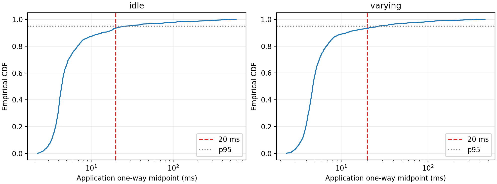

# Báo cáo SV2 / Edge — Tuần 9

**Ngày xuất bản:** 09/11/2026. **Phạm vi:** tải nền Poisson, hàng đợi KV260,
MQTT trạng thái mỗi 100 ms và phép đo một chiều do SV2 tự thực hiện.
Báo cáo tổng hợp dữ liệu đã lưu; khi xuất bản không chạy lại inference hoặc radio.

## 1. Kết quả và phạm vi kết luận

Hai lượt đo đạt **trung bình độ trễ ứng dụng dưới 20 ms** theo tiêu chí SV2
chọn để báo cáo: idle **12,643 ms**, varying **10,601 ms**. Ngay cả trung bình
cận trên của mô hình đồng hồ cũng dưới ngưỡng: **13,338 / 11,409 ms**.
P95 và cực đại vẫn vượt 20 ms; không kết luận mọi thông điệp đều đạt ngưỡng.

Bên nhận là **GW_TRUNG, role=gateway, Windows native trên chính PC SV2**.
Đây là bằng chứng tự đo KV260 → gateway; chưa phải bằng chứng PC SV1 nhận
trạng thái. Tiêu chí trung bình và phạm vi gateway là lựa chọn báo cáo của SV2,
chưa được ghi nhận là quyết định nghiệm thu chung của nhóm/GV. Review vẫn chờ.

| Hạng mục | Kết quả đã xác minh |
|---|---|
| Tải Poisson từ CSV λ(t), seed cố định | Có source, cấu hình và log lượt thực |
| FIFO hữu hạn, worker native thực | Varying: 1504 job đến, 1257 hoàn thành, 247 bị loại do đầy |
| Publish trạng thái chu kỳ 100 ms | 901/901 và 1501/1501 gửi/nhận; không lỗi publish |
| Một chiều trong mô hình affine khả thi | Tính lại từ toàn bộ probe và thông điệp, khớp kết quả lưu |
| Trung bình <20 ms | Đạt ở hai lượt, kể cả trung bình cận trên |
| P95 / cực đại / mọi mẫu <20 ms | Chưa đạt; giữ đầy đủ ngoại lệ |
| B5 lịch sử, độc lập MQTT | Đối chiếu Edge p1/p2/p4; Device công bố p1/p4 PASS, p2 FAIL |
| BLE foreground/reconnect cùng tải MQTT | Có hook và test mô phỏng; hai lượt tự đo không thực thi đường này |
| Báo cáo, cấu hình và export Git | Có; chờ review qua PR, không tự nâng thành toàn tuần PASS |

Số liệu gốc cho mọi bảng dưới đây nằm trong
[summary.json](../results/week9/edge/summary.json),
[bảng từng thông điệp](../results/week9/edge/latency_samples.csv) và
[bảng chu kỳ](../results/week9/edge/mqtt_intervals.csv).

## 2. Setup và cấu hình đã chạy

- KV260: PetaLinux 2022.1 / Vitis AI 2.5, DPU B4096; s2 root GraphRunner
  gồm CPU plugins và DPU. Worker persistent, không lấy logits từ bảng tham chiếu.
- Input ứng dụng NCL `[1,16,180]`, chuyển sang tensor XIR NTC `[1,180,16]`
  XINT8, fix_point=5; output 5 logits FP32. Không dùng model NoPeek mới để
  thay model tích hợp đã pin trong các lượt này.
- KV260 nối LAN; PC SV2 dùng Wi-Fi (`PC_WIFI_KV260_LAN`). Broker chạy trong
  WSL trên cùng PC; receiver dùng Python Windows native 3.11.9 / Paho 2.1.0.
- Timestamp nhận: Windows QueryPerformanceCounter, độ phân giải được khai báo
  100 ns. Độ phân giải này không phải chứng nhận sai số thời gian vật lý.
- Topic hiện dùng `adaptive_split/edge/KV260_NODE_01/status`, QoS 0,
  retained=false, TCP_NODELAY. Giữ topic hiện hành; không sửa I1/I2/registry
  hoặc tự công bố một revision I4 đã được nhóm duyệt.

```text
KV260 publisher :1892 → reverse SSH → broker PC/WSL :1891
Windows GW_TRUNG :1891 → broker cùng PC :1891
Windows probe :1906 → SSH → clock server KV260 :1896
```

| Tham số thí nghiệm | Giá trị |
|---|---|
| Seed | 20261027 |
| Idle | 90 s, λ=0 job/s |
| Varying | 5 pha ×30 s, λ=0 / 5 / 15 / 30 / 0 job/s |
| Hàng đợi | FIFO; tối đa 8 background +1 foreground chờ, không tính job đang chạy |
| Khi đầy | Loại job background mới và ghi drop; không xóa khỏi thống kê |
| Warm-up | 20 input thực mỗi lượt, trước thời gian queue và publish |
| Chu kỳ trạng thái | 100 ms, có trạng thái tại mốc đầu nên số bản tin là 901/1501 |

Cấu hình portable nằm tại [experiments/configs](../experiments/configs/sv2_edge_week9.json)
và [CSV kịch bản](../experiments/configs/sv2_edge_week9/).
Model SHA-256 `68c5f86b5ca60479176aa7a5da0e9fef5b79ac436b43468e8ba0ae5353deeaa9`;
worker SHA-256 `9f542a2c5aaaf97e94a08a7c529ddd371e0894e5e74f9c5962bc31b5e6da222b`.
Hash NPZ, bundle và từng CPU plugin được giữ đầy đủ trong
[provenance](../results/week9/edge/provenance.json).

## 3. Phương pháp đo và giới hạn đồng hồ

Độ trễ bắt đầu ở timestamp trong vòng publish trên KV260, trước tạo payload
và gọi publish; kết thúc khi callback MQTT vào receiver Windows. Nó bao gồm
overhead ứng dụng, tunnel, broker và lịch chạy callback. Đây không phải thời
gian vô tuyến thuần, thời gian suy luận hay ACK RTT/2.

Analyzer dùng bốn timestamp probe hai chiều để tìm tập quan hệ affine khả thi
giữa hai đồng hồ monotonic, áp ràng buộc nhân quả mà không giả sử hai chiều
mạng có độ trễ bằng nhau. Với mỗi thông điệp, xuất cận dưới, midpoint và
cận trên qua toàn bộ tập mô hình khả thi. Khoảng này không phải khoảng tin cậy
thống kê; kết luận phụ thuộc giả thiết quan hệ affine và độ phân giải khai báo.
Không bỏ probe hoặc ngoại lệ để làm kết quả đạt. Lưu lượng calibration có
mặt trong chính lượt đo.

| Kiểm đồng hồ | Idle | Varying |
|---|---:|---:|
| Probe hợp lệ / lỗi probe | 1263 / 0 | 1252 / 0 |
| Khoảng cách probe lớn nhất (ms) | 648,820 | 617,822 |
| Drift khả thi (ppm) | −22,038 … −9,162 | −21,978 … −9,765 |
| Độ rộng khoảng một chiều lớn nhất (ms) | 1,461 | 1,631 |

Preflight kiểm tính khả thi và ngân sách căn chỉnh 5 ms là guard kỹ thuật;
nó không thay kiểm toàn lượt hoặc là tiêu chí nghiệm thu dự án. Luồng WSL cũ
đã có clock không nhất quán; kết quả đó được giữ lịch sử, không trộn vào hai
lượt native Windows dưới đây. Chưa có kiểm chuẩn thời gian bằng thiết bị ngoài.

## 4. Độ trễ và chất lượng nhận trạng thái

Các thống kê midpoint có đơn vị **ms**. Std dùng mẫu (`ddof=1`), percentile
dùng nearest rank; mọi 2402 bản tin của hai lượt đều được giữ trong CSV.

| Chỉ số | Idle `idle-0829fe8cf791` | Varying `varying-a6fbc654063b` |
|---|---:|---:|
| Gửi / nhận đúng lượt | 901 / 901 | 1501 / 1501 |
| Lỗi publish | 0 | 0 |
| Mean | 12,643 | 10,601 |
| Std | 44,377 | 31,179 |
| P50 | 4,344 | 4,702 |
| P95 | 26,659 | 27,386 |
| P99 | 279,671 | 137,337 |
| Max | 586,681 | 457,400 |
| Trung bình cận dưới … cận trên | 11,947 … 13,338 | 9,794 … 11,409 |
| Cận dưới … cận trên của max | 585,968 … 587,394 | 456,585 … 458,214 |
| Chắc chắn <20 trong mô hình (`upper<20`) | 841 (93,34%) | 1397 (93,07%) |
| Chắc chắn ≥20 (`lower>=20`) | 57 | 97 |
| Khoảng chứa ngưỡng, chưa phân biệt | 3 | 7 |

Analyzer kiểm đủ sequence, payload, identity, thứ tự và coverage, không chỉ
đếm số dòng. Nhận đủ ở hai lượt QoS 0 này không bảo đảm mọi lượt sau không mất.

| Chu kỳ bản tin (ms) | Idle mean / p95 / max | Varying mean / p95 / max |
|---|---|---|
| Publisher | 100,000 / 100,016 / 100,151 | 100,000 / 100,036 / 100,786 |
| Receiver | 100,000 / 112,056 / 682,148 | 100,000 / 113,227 / 553,391 |

Mỗi lượt có **2 khoảng nhận >500 ms**, lớn nhất idle **682,148 ms**, varying
**553,391 ms**. Không bỏ các khoảng này dù trung bình đạt. Chưa có bằng chứng
phân lập nguyên nhân spike giữa Wi-Fi, SSH, broker và lịch chạy ứng dụng.
`dpu_utilization_ratio=null` biểu thị chưa đo, không phải DPU sử dụng 0%.



[PDF biểu đồ](../results/week9/edge/figures/mqtt_latency_cdf.pdf) dùng được cho
báo cáo; trục x log để giữ cả ngoại lệ lớn mà vẫn quan sát phần chính.

## 5. Hàng đợi và thời gian xử lý

Idle không có job queue. Varying có **1504 arrived =1257 completed +247 drop**,
foreground=0, failure=null. FIFO bảo toàn thứ tự job được chấp nhận; loại khi
đầy là hành vi cấu hình hữu hạn, không phải 247 job lỗi suy luận.

| Varying, 1257 job hoàn thành | Mean (ms) | Std (ms) | P95 (ms) | Max (ms) |
|---|---:|---:|---:|---:|
| Service | 46,264 | 0,307 | 46,913 | 49,527 |
| Chờ background trong queue | 187,288 | 146,256 | 367,781 | 375,732 |

Service tính cả dispatch/native/backend CPU+DPU, không phải DPU-only.
Warm-up 20 input mất 925,399 /926,059 ms, đã loại khỏi cửa sổ queue/MQTT.
Ngưỡng 20 ms ở đây áp dụng đường trạng thái MQTT, không áp vào thời gian
hoàn tất job model hoặc tổng thời gian chờ suy luận.

## 6. B5 lịch sử — đối chiếu riêng với Device

Đây là hồ sơ đã đo trước đó, không phải điều kiện phối hợp đo mới cho luồng
MQTT tự thực hiện. Service energy ở commit `948297f9` dùng một kết nối,
Set/Read PHY 2M trước request, không Poisson/MQTT. Đã kiểm lại cả ba lượt
p1/p2/p4: mỗi lượt 200/200 OK, 100 cặp P0/P1, logits trùng bit offline 200/200;
hash requests trùng chính log mà importer Device đã dùng.

[b5_review.json](../results/week9/edge/b5_review.json) giữ hash nguồn, PHY gate,
checker và kết luận riêng từng lượt. Đã kiểm 139 file theo manifest Device.
Theo [báo cáo Device tuần 9](sv1_device_week9_report.md), p1/p4 PASS 19/19
check; p2 FAIL do mất 48 mẫu PPK2, p3 hỏng do laptop chạy pin. Giữ các lượt
lỗi; không suy 200 OK phía Edge thành PASS năng lượng. Link 2M/2M, interval
15 ms, latency 0, timeout 4 s là kết luận lịch sử từ hồ sơ Device/btmon.
Xuất bản lần này không tính lại năng lượng từ raw PPK2 hoặc chạy checker trên
thiết bị. Kết quả năng lượng gốc nằm ở [hồ sơ Device](../results/week9/device/README.md).

## 7. Truy vết, tái tạo và kiểm tra

Source queue/publisher/clock/native receiver công bố tại commit **`54320ff`**:
[edge/server/week9](../edge/server/week9/README.md). Mười file thực đo được
so byte với snapshot, ghi SHA trong [source_versions.json](../results/week9/edge/source_versions.json).
Commit công bố này ra đời sau acquisition; không gán HEAD cũ thành commit
đã chứa source queue. Helper prepare/export mới phục vụ tái lập, không giả
là mã đã chạy trong buổi đo ban đầu.

W10 `gui_review_windows.zip` có 725535 byte, SHA-256
`9df14cf5ddeb57c2a5dc5a461dd0f91d2b45589f2d4257535e768dd67b46c5d9`.
Exporter kiểm SHA/CRC, nội dung ZIP so raw nhận, manifest các input, backend,
source, payload và tính lại toàn bộ JSON/per-message bounds trong thư mục tạm.
Raw được giữ nguyên tại kho artifact cục bộ, bàn giao ngoài Git; không đưa
khóa, NPZ, model, binary, venv, trace hay ghi chú riêng vào bản xuất công khai.

Các kiểm tra HOST ngày 09/11/2026 đều qua, không có test bị skip trong môi trường này:

```bash
python3 -B -m unittest discover -s edge/tests -p 'test_week9*.py'
python3 -B contracts/i1v2_ref/test_i1v2.py
python3 -B contracts/i2_ref/test_i2.py
```

Tổng **67 test**: queue 8, clock/oneway 15, native control 4, exporter 5,
energy 7, I1 v2 23, I2 5. Test dùng NumPy/Paho và GCC cho codec C; một số
case có fixture/mocks, case replay thực dùng raw đã lưu. Checkout không có
raw/NPZ sẽ skip rõ các case tùy chọn, không tạo số liệu thay thế.
Không chạy lại board, firmware build/flash, ML training hoặc chứng nhận đồng hồ.

Chỉ có Git: kiểm checksum theo [README kết quả](../results/week9/edge/README.md),
hoặc mở [notebook chỉ đọc](../experiments/notebooks/sv2_edge_week9.ipynb).
Có raw xác thực: dùng [exporter](../edge/export_week9_evidence.py) vào output
mới; không ghi đè artifact lịch sử. Định nghĩa đơn vị/nguồn được giữ trong JSON/CSV.

## 8. Việc còn chờ review

- Review source và số liệu qua PR nhánh SV2; không tự merge vào `main`.
- Xác nhận phạm vi gateway và tiêu chí trung bình khi nghiệm thu chung;
  trạng thái hiện tại là `REVIEW_REQUIRED`, không phải PC SV1 đã nhận.
- Giữ p95/max, uncertainty và receive gaps trong mọi trích dẫn báo cáo.
- Topic/schema I4 và `null` utilization cần xác nhận chung nếu được chuẩn hóa;
  bản này không tự sửa hợp đồng. BLE foreground/reconnect dưới tải chưa có
  bằng chứng trong hai lượt MQTT; không lấy test mock hoặc B5 thay thế.

Các điểm trên mô tả giới hạn bằng chứng và review, không đặt thêm buổi phối hợp
SV1 vào quy trình đo gateway mà SV2 đã chọn.
